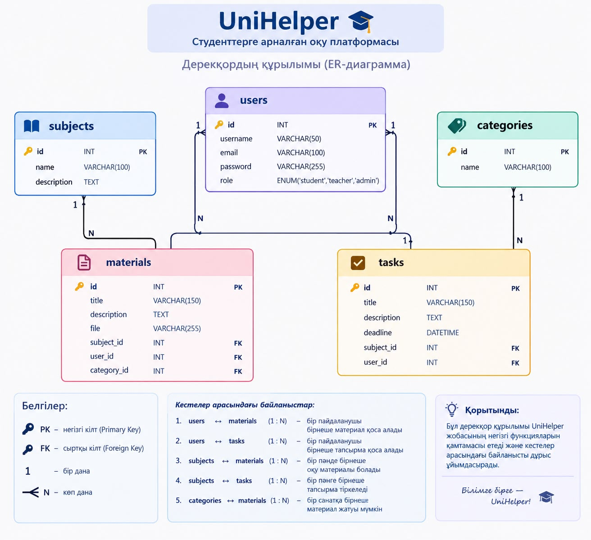

# UniHelper — студенттерге арналған оқу платформасы

## Жоба туралы

Бұл веб-қосымша студенттерге оқу материалдарын табуға, пәндер бойынша ақпарат алуға, тапсырмаларды қарауға және өздерінің оқу үдерісін ұйымдастыруға мүмкіндік береді. Жоба PHP және MySQL көмегімен әзірленеді.

## Негізгі мүмкіндіктер

- Пайдаланушыларды тіркеу және жүйеге кіру (Authentication)
- Оқу материалдарын қосу, қарау, өңдеу және жою (CRUD)
- Пәндер мен оқу материалдары бойынша іздеу
- Пәндер мен санаттар бойынша сүзу
- Тапсырмалар мен оқу ресурстарын қарау
- Студенттің жеке кабинетін ұйымдастыру
- Қауіпсіздік және деректерді валидациялау

## Дерекқор құрылымы (Кестелер)

- **users**: Пайдаланушылар туралы мәліметтер (id, username, email, password, role)
- **subjects**: Пәндер туралы ақпарат (id, name, description)
- **materials**: Оқу материалдары (id, title, description, file, subject_id, user_id)
- **tasks**: Тапсырмалар (id, title, description, deadline, subject_id, user_id)
- **categories**: Материалдар санаттары (id, name)

## Негізгі беттер тізімі

1. `index.php` — Басты бет
2. `catalog.php` — Оқу материалдарының каталогы
3. `material_detail.php` — Оқу материалының толық сипаттамасы
4. `register.php` / `login.php` — Тіркелу және жүйеге кіру
5. `add_material.php` — Жаңа оқу материалын қосу
6. `tasks.php` — Тапсырмалар тізімі
7. `profile.php` — Студенттің жеке кабинеті

## Технологиялар

- **Frontend:** HTML5, CSS3, JavaScript
- **Backend:** PHP
- **Database:** MySQL
Дерекқор құрылымы (Database Schema)

UniHelper жобасының дерекқоры MySQL жүйесінде жасалады және 5 негізгі кестеден тұрады: users, subjects, materials, tasks және categories. Бұл кестелер пайдаланушылар, пәндер, оқу материалдары, тапсырмалар және материалдар санаттары туралы ақпаратты сақтайды. Кестелер арасында сыртқы кілттер (Foreign Key) арқылы байланыс орнатылған. Дерекқор құрылымы ақпаратты тиімді сақтауға, іздеуге және басқаруға мүмкіндік береді.

